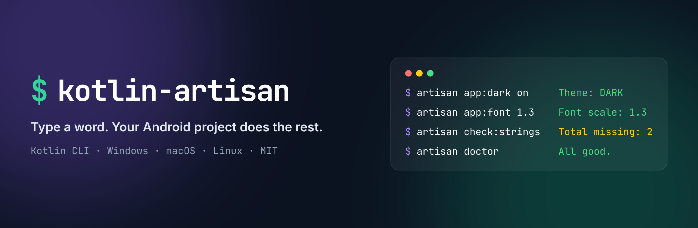
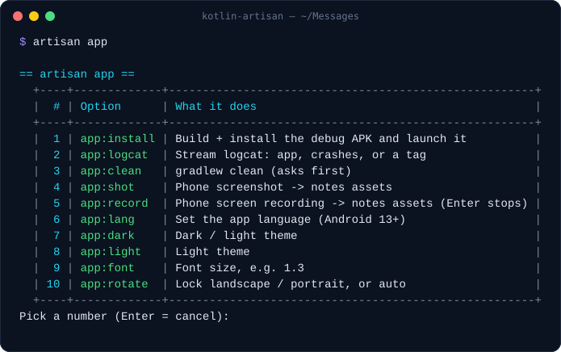
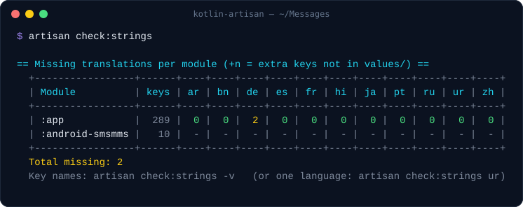
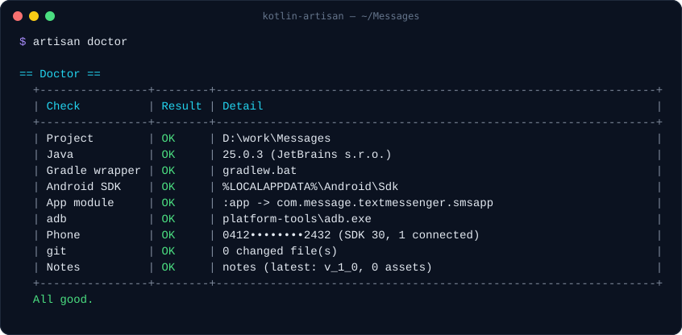
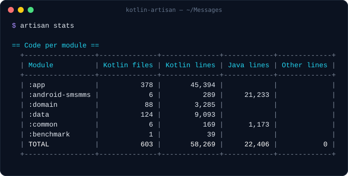

<p align="center">
  <a href="https://github.com/ravisorathiya/kotlin-artisan"></a>
</p>

<p align="center">
  <a href="https://github.com/ravisorathiya/kotlin-artisan/releases/latest"></a>
  <a href="LICENSE"></a>
  
  
</p>

<p align="center">
  <b><a href="#install">Install</a></b> ·
  <a href="#setup-java-and-adb">Setup</a> ·
  <a href="#30-second-tour">30-second tour</a> ·
  <a href="#commands">All commands</a> ·
  <a href="#ai-agent-workspace">AI agent workspace</a>
</p>

# kotlin-artisan

**An `artisan`-style command line for Android projects.** Type a word and the phone switches to dark mode, takes a
screenshot, installs the build, shows missing translations, or opens Crashlytics. Written in Kotlin and runs
anywhere a JDK runs (Windows, macOS, Linux).

<p align="center">
  
  
</p>

<sub>Real output from v0.2.0 on a production Android app (paths and device serial masked).</sub>

## Why

| Feature | What you get |
|---|---|
| ⚡ **Zero setup** | Run it anywhere inside a Gradle project. It finds the root, the modules (Kotlin or Groovy DSL), the app module, `applicationId`, version, and Firebase project by itself. |
| 🧰 **Easy tool setup** | Missing Java or adb? The Windows installer and `artisan setup` reuse Android Studio's JDK and SDK, or install them with `winget` / `brew`. Guide: [Setup](#setup-java-and-adb). |
| ⌨️ **Suggestions as you type** | At your normal prompt, `artisan da` shows `app:dark` in gray as you type; → accepts (PowerShell 5.1 and 7, zsh, fish). Or run `artisan` and type to search every command (`dark`, `translation`, even `drak`). `artisan app:<Tab>` completes with descriptions. |
| 🏭 **Generators for the repetitive parts** | `make:string` (every locale at once), `make:event` + `check:events` (event.md and its Excel sheet in sync, naming rules checked), `make:permission` (the full ask/deny/Settings flow with events), `make:screen`, `bump`, `make:bundle` (git diff → re-apply bundle), `make:analytics` (firebaseEvent + event box). |
| ⌨️ **In your terminal, not only a CLI** | Ctrl+g hotkeys (`i` install, `s` screenshot, `l` logcat...), project status in your prompt, git hooks that stop commits with event.md or translations out of sync, clickable output paths. |
| 🔢 **Pickers instead of memorising** | `artisan make`, `artisan app` and `artisan open` show just that group's commands. Leave out a value (`artisan app:font`) and it shows the choices. |
| 🎨 **Readable output** | Coloured boxed tables that fit your terminal. |
| 📱 **Phone switches for QA** | Dark/light, font scale, rotation, per-app language, screenshot, screen recording, logcat, type text, deep links, grant/revoke/reset permissions, clear data, demo status bar, mirror (scrcpy). |
| 🩺 **Project health** | Missing translations per module × language, TODO/FIXME summary, lines of code, `doctor`. |
| 🗒️ **Optional notes workspace** | Versions → phases → bugs, plans, and screenshots for a team or an AI agent: `make:plan`, `make:bug`, `status`, `list:verify`. |
| 🧩 **Your own commands** | Add shell commands in `artisan.json` and they show up in the pickers. |

## Install

Needs Java 17+ (Android Studio's bundled JDK works) and, for the phone commands, `adb` on your PATH. The Windows
installer sets both up for you: it reuses Android Studio's copies or installs them with `winget`. For macOS/Linux or
manual setup, see [Setup: Java and adb](#setup-java-and-adb).

**Windows (PowerShell)**
```powershell
irm https://raw.githubusercontent.com/ravisorathiya/kotlin-artisan/main/install.ps1 | iex
```

**macOS / Linux**
```sh
curl -fsSL https://raw.githubusercontent.com/ravisorathiya/kotlin-artisan/main/install.sh | sh
```

Both install `kotlin-artisan` and a short alias `artisan` into a user folder and add it to your PATH. Open a new
terminal afterwards.

### Setup: Java and adb

| What | Why | Check |
|---|---|---|
| **Java 17+** | artisan runs on the JVM (and Gradle needs it to build your app) | `java -version` |
| **adb** (platform-tools) | every `app:*` command talks to the phone through it | `adb version` |

With Android Studio installed you have both; they may just not be on your PATH. `artisan setup` fixes that: it
reuses Studio's bundled JDK (`<Android Studio>/jbr`) and the SDK's `platform-tools`, else installs them with
`winget` / `brew`. On Windows the installer offers the same (set `$env:ARTISAN_YES = '1'` to accept every offer).
By hand:

```sh
winget install -e --id EclipseAdoptium.Temurin.21.JDK; winget install -e --id Google.PlatformTools   # Windows
brew install --cask temurin@21 && brew install android-platform-tools                                 # macOS
sudo apt install openjdk-17-jdk adb                                                                    # Debian / Ubuntu
```

Or point `JAVA_HOME` at Studio's `jbr` and add `$JAVA_HOME/bin` and `<sdk>/platform-tools` to PATH. Open a new
terminal afterwards.

### Updating

```sh
artisan self:update        # downloads and installs the latest release (asks first; -y to skip)
```

artisan also checks GitHub at most once a day in the background. When a newer release exists, it prints one line
after your command: `kotlin-artisan 0.9.0 is available (you have 0.8.0). Update: artisan self:update`. The check
never slows a command by more than ~1.5 s, stays quiet when you're offline, and is off on CI. Turn it off with
`ARTISAN_NO_UPDATE_CHECK=1`.

> Installed **0.1.0**? It doesn't have `self:update` yet, so run the install command above once. After that,
> `artisan self:update` is enough.

**From source**
```sh
git clone https://github.com/ravisorathiya/kotlin-artisan && cd kotlin-artisan
./gradlew installDist        # -> build/install/kotlin-artisan/bin/{kotlin-artisan,artisan}
```

## 30-second tour

```sh
artisan                        # type to search every command; Tab fills in, Enter runs
artisan app:<Tab>              # Tab completion with descriptions (artisan completion --install)
artisan doctor                 # Java, SDK, adb, phone, git: what's OK, what's missing
artisan setup                  # put adb on PATH + set JAVA_HOME (SDK copy, else winget/brew)
artisan app:install            # build + install + launch the debug app   (or Ctrl+g i)
artisan make:string call_ended "Call ended"   # values/ + every values-xx/ at once
artisan make:event SplashActivity splash_on_create "Splash shown"   # event.md row + sheet + firebaseEvent line
artisan make:permission HomeActivity contact noti   # permission flow + its events + manifest entries
artisan make:screen activity Settings          # class + layout + manifest entry
artisan app:reset-perms        # test the first-run permission flow again
artisan bump minor             # 1.7 -> 1.8, versionCode +1, next workflow folder
artisan hooks install          # stop commits with event.md / translations out of sync
artisan app:dark on            # dark theme on the phone   (artisan app:light to go back)
artisan app:font 1.3           # large font                (artisan app:font reset)
artisan app:rotate land        # lock landscape            (artisan app:rotate auto)
artisan app:shot               # screenshot into the notes assets folder
artisan app:logcat             # pick: this app / crashes only / your tags
artisan check:strings          # missing translations, one row per module, one column per language
artisan open:firebase crash    # Crashlytics for this project
artisan list                   # everything
```

## Commands

| Group | Commands |
|---|---|
| — | `find [words]` `list` `version` `doctor` `setup` `completion [shell]` `hotkeys` `hooks` `bump` `init [notes]` `status` `stats` |
| `self:` | `update` |
| `make:` | `string` `event` `permission` `screen` `bundle` `analytics` `plan` `version` `phase` `bug [--shot]` `ai` |
| `event:` | `sheet` |
| `del:` | `asset` |
| `check:` | `strings [lang] [-v]` `events` `staged` `links` `assets` |
| `list:` | `verify [-md]` `plans` `todo [module] [-v]` |
| `app:` | `install` `logcat [tag]` `clean` `shot [name]` `record [name] [sec]` `lang [code]` `dark [on\|off]` `light` `font [scale]` `rotate [land\|port\|auto]` `text` `open` `grant` `revoke` `reset-perms` `clear` `demo` `mirror` |
| `open:` | `firebase [overview\|crash\|config\|analytics]` `play` `admob` `app` `studio` `report` `folder` |
| `build:` | `release [apk\|aab]` |

<p align="center">
  
  
</p>

Every command explains itself: `artisan list` shows them all, and `artisan <command>` with a value left out asks
for it.

Flags: `-y` skips "yes" confirmations, `-v` shows details, `-md` prints markdown (`list:verify`).

**Output for scripts and AI agents.** In a terminal you get boxed, coloured tables. When the output goes to a
pipe, a file or an AI coding agent, tables print as compact tab-separated rows (`== Title ==`, then a header line
and the rows): about half the size, with no truncation, and ready for `cut -f2` / `awk -F'\t'`. Force it either
way with `--plain` / `--table`, or set `ARTISAN_PLAIN=1` / `ARTISAN_PLAIN=0`.
Set `ARTISAN_DEBUG=1` to get the stack trace when something fails unexpectedly.

## Configuration (optional)

`artisan init` writes an `artisan.json` with what it detected. Every key is optional:

```json
{
  "package": "com.example.app",
  "appModule": ":app",
  "notes": { "dir": "docs/notes" },
  "logcat": { "tags": ["MyTag", "OkHttp"] },
  "ignoreModules": [":benchmark"],
  "extraSources": ["*.js"],
  "hotkeys": { "u": "deploy:beta" },
  "commands": {
    "deploy:beta": { "description": "Upload a beta to Firebase App Distribution", "run": "./gradlew appDistributionUploadRelease" }
  }
}
```

| Key | What it does |
|---|---|
| `package` | Overrides the detected `applicationId` (used by install, logcat, lang, open:app) |
| `appModule` | Which module is the app, when there's more than one `com.android.application` |
| `notes.dir` | Where the notes workspace lives (default `notes/` if it exists) |
| `logcat.tags` | Extra choices in the `app:logcat` picker |
| `ignoreModules` | Modules skipped by `stats` and `list:todo` |
| `extraSources` | Extra file globs counted by `stats` / scanned by `list:todo` |
| `hotkeys` | Change or add Ctrl+g hotkeys for this project |
| `commands` | Your own commands; a name with `:` joins (or creates) a group picker |

Environment variables:

| Variable | Effect |
|---|---|
| `ARTISAN_PLAIN=1` / `0` | Force plain tab-separated output / boxed tables |
| `ARTISAN_DEBUG=1` | Print the stack trace when something fails unexpectedly |
| `ARTISAN_NO_UPDATE_CHECK=1` | No daily update check |
| `ARTISAN_NO_LIVE_HINTS=1` | No gray suggestions at the prompt |
| `ARTISAN_NO_MENU_TAB=1` | Leave PowerShell's Tab binding alone |
| `ARTISAN_NO_HOTKEYS=1` | No Ctrl+g hotkeys |
| `ARTISAN_HOTKEY_LEADER=Ctrl+k` | Another hotkey leader |
| `ARTISAN_NO_PROMPT=1` | No project status in the prompt |
| `ARTISAN_SKIP_HOOKS=1` | Git hooks do nothing |
| `ARTISAN_YES=1` | The Windows installer accepts every offer |

## Notes workspace (optional)

`artisan init notes` creates:

```text
notes/
  README.md
  workflow/v_1_0/overview.md   phase table for version 1.0
  workflow/v_1_0/phase_1.md    ## Changes / ## Bugs
  plans/                       one file per feature or fix
  assets/                      screenshots and recordings (app:shot, app:record, del:asset)
```

Then `make:plan`, `make:phase`, `make:version`, `make:bug`, `status`, `list:plans`, `list:verify`, `check:links`
and `check:assets` keep it tidy. It's plain markdown, so it works for a team, or as cross-session memory for AI
coding agents.

## AI agent workspace

`artisan make:ai` adds an `:ai` Gradle module with the workspace in `ai/src/main/java/ai/`. It's visible in Android
Studio and never shipped. It's plain markdown, grouped by folder:

| Where | What goes there |
|---|---|
| `README.md` | The agent rules: a quick map, a start-here checklist, one section per folder, how to write notes, analytics sync |
| `workflow/v_1_0_alpha/` | Bug lists and feedback rounds, one `phase_N.md` each, plus `overview.md` |
| `plan/` | Plans (`make:plan <name>`: one `.md` file) and re-apply bundles (`make:bundle <feature> --since <tag>`), indexed in `plan/MASTER_OVERVIEW.md` |
| `event/event.md` | Every `firebaseEvent(...)` call, pre-filled from the app, one table per screen |
| `event/event_sheet.xlsx` | The same events as a spreadsheet for product and QA. Generated, never edited by hand |
| `skill/` | Reusable how-tos every project gets: `permission.md`, `analytics_events.md`, `crash_hardening.md` |
| `scripts/` | Helper scripts agents run (rules in its README; `recolor.py` makes theme image variants) |
| `assets/` | Screenshots and recordings |

Run `make:ai` again in a project that already has the workspace: it adds only the missing skills, scripts and sheet.

**Events out of the box.**

- `make:analytics` adds `firebaseEvent()` and the event box.
- `make:event` adds a row, checking the name: snake_case, under 30 characters.
- `check:events` compares the code and event.md both ways.
- `artisan hooks install` stops a commit when they disagree. The hook also rebuilds `event_sheet.xlsx` and stages it,
  so the sheet always matches event.md (`event:sheet` rebuilds it by hand).

**Permissions out of the box.** `artisan make:permission HomeActivity phone=READ_PHONE_STATE,CALL_PHONE contact noti`
writes `PermissionFlow.kt` once per app. The flow:

- remembers a first denial and a permanent one per permission;
- moves on to the next permission instead of asking the same one again;
- sends the user to Settings once Android won't show the prompt any more;
- fires `<screen>_<key>_ask/grant/deny_1st/deny_2nd/back` and `<screen>_setting_show/close/dismiss`.

The command also adds those events to event.md and the sheet, adds the missing `<uses-permission>` lines, and prints
the one property to paste:

```kotlin
private val permissions = PermissionFlow(this, "home", listOf(
    PermissionGroup("contact", Manifest.permission.READ_CONTACTS),
    PermissionGroup("noti", Manifest.permission.POST_NOTIFICATIONS, minSdk = 33),
))
// button: permissions.ask()    onResume: permissions.ask()
```

A re-apply bundle snapshots what changed into `plan/<feature>/`, so a shipped feature can be ported into a new copy
of the project without re-designing it. The notes commands find the workspace without any config.

## Contributing

Issues and PRs welcome. See [CONTRIBUTING.md](CONTRIBUTING.md).

If artisan saves you a few clicks, a ⭐ helps other Android devs find it.

## License

[MIT](LICENSE) © 2026 ravisorathiya
