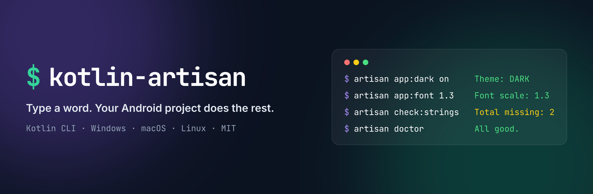
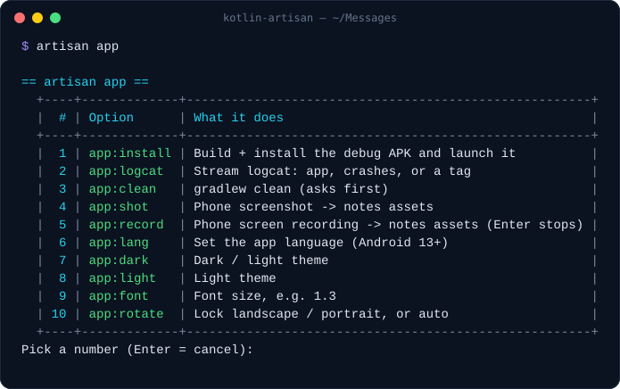
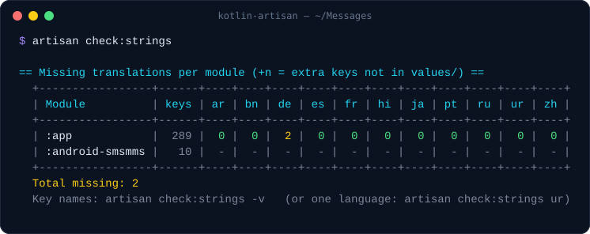
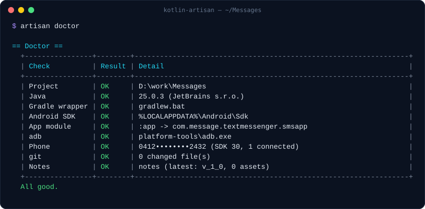
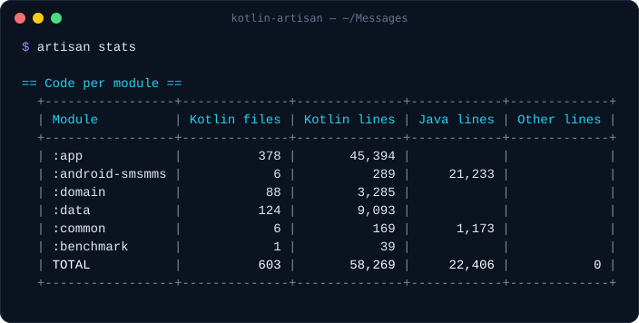

<p align="center">
  <a href="https://ravisorathiya.github.io/open-source/kotlin-artisan"></a>
</p>

<p align="center">
  <a href="https://github.com/ravioriginfo/kotlin-artisan/releases/latest"></a>
  <a href="LICENSE"></a>
  
  
</p>

<p align="center">
  <b><a href="https://ravisorathiya.github.io/open-source/kotlin-artisan">Website</a></b> ·
  <a href="#install">Install</a> ·
  <a href="#30-second-tour">30-second tour</a> ·
  <a href="docs/commands.md">All commands</a>
</p>

# kotlin-artisan

**An `artisan`-style command line for Android projects.** Type a word and the phone switches to dark mode, takes a
screenshot, installs the build, shows missing translations, or opens Crashlytics. Written in Kotlin and runs
anywhere a JDK runs (Windows, macOS, Linux).

<p align="center">
  
  
</p>

<sub>Real output from v0.2.0 on a production Android app (paths and device serial masked).</sub>

## Why

| Feature | What you get |
|---|---|
| ⚡ **Zero setup** | Run it anywhere inside a Gradle project. It finds the root, the modules (Kotlin or Groovy DSL), the app module, `applicationId`, version, and Firebase project by itself. |
| 🧰 **Easy tool setup** | Missing Java or adb? The Windows installer and `artisan setup` reuse Android Studio's JDK and SDK, or install them with `winget` / `brew`. Guide: [docs/setup.md](docs/setup.md). |
| 🔢 **Pickers instead of memorising** | `artisan make`, `artisan app` and `artisan open` show just that group's commands. Leave out a value (`artisan app:font`) and it shows the choices. |
| 🎨 **Readable output** | Coloured boxed tables that fit your terminal. |
| 📱 **Phone switches for QA** | Dark/light, font scale, rotation, per-app language, screenshot, screen recording, logcat. |
| 🩺 **Project health** | Missing translations per module × language, TODO/FIXME summary, lines of code, `doctor`. |
| 🗒️ **Optional notes workspace** | Versions → phases → bugs, plans, and screenshots for a team or an AI agent: `make:plan`, `make:bug`, `status`, `list:verify`. |
| 🧩 **Your own commands** | Add shell commands in `artisan.json` and they show up in the pickers. |

## Install

Needs Java 17+ (Android Studio's bundled JDK works) and, for the phone commands, `adb` on your PATH. The Windows
installer sets both up for you: it reuses Android Studio's copies or installs them with `winget`. For macOS/Linux or
manual setup, see [docs/setup.md](docs/setup.md).

**Windows (PowerShell)**
```powershell
irm https://raw.githubusercontent.com/ravioriginfo/kotlin-artisan/main/install.ps1 | iex
```

**macOS / Linux**
```sh
curl -fsSL https://raw.githubusercontent.com/ravioriginfo/kotlin-artisan/main/install.sh | sh
```

Both install `kotlin-artisan` and a short alias `artisan` into a user folder and add it to your PATH. Open a new
terminal afterwards.

### Updating

```sh
artisan self:update        # downloads and installs the latest release (asks first; -y to skip)
```

artisan also checks GitHub at most once a day in the background. When a newer release exists, it prints one line
after your command: `kotlin-artisan 0.3.0 is available (you have 0.2.0). Update: artisan self:update`. The check
never slows a command by more than ~1.5 s, stays quiet when you're offline, and is off on CI. Turn it off with
`ARTISAN_NO_UPDATE_CHECK=1`.

> Installed **0.1.0**? It doesn't have `self:update` yet, so run the install command above once. After that,
> `artisan self:update` is enough.

**From source**
```sh
git clone https://github.com/ravioriginfo/kotlin-artisan && cd kotlin-artisan
./gradlew installDist        # -> build/install/kotlin-artisan/bin/{kotlin-artisan,artisan}
```

## 30-second tour

```sh
artisan doctor                 # Java, SDK, adb, phone, git: what's OK, what's missing
artisan setup                  # put adb on PATH + set JAVA_HOME (SDK copy, else winget/brew)
artisan app:install            # build + install + launch the debug app
artisan app:dark on            # dark theme on the phone   (artisan app:light to go back)
artisan app:font 1.3           # large font                (artisan app:font reset)
artisan app:rotate land        # lock landscape            (artisan app:rotate auto)
artisan app:shot               # screenshot into the notes assets folder
artisan app:logcat             # pick: this app / crashes only / your tags
artisan check:strings          # missing translations, one row per module, one column per language
artisan open:firebase crash    # Crashlytics for this project
artisan list                   # everything
```

## Commands

| Group | Commands |
|---|---|
| — | `list` `version` `doctor` `setup` `init [notes]` `status` `stats` |
| `self:` | `update` |
| `make:` | `plan` `version` `phase` `bug` |
| `del:` | `asset` |
| `check:` | `links` `assets` `strings [lang] [-v]` |
| `list:` | `verify [-md]` `plans` `todo [module] [-v]` |
| `app:` | `install` `logcat [tag]` `clean` `shot [name]` `record [name] [sec]` `lang [code]` `dark [on\|off]` `light` `font [scale]` `rotate [land\|port\|auto]` |
| `open:` | `firebase [overview\|crash\|config\|analytics]` `play` `admob` `app` `studio` `report` |
| `build:` | `release [apk\|aab]` |

<p align="center">
  
  
</p>

Full reference with examples: [docs/commands.md](docs/commands.md).

Flags: `-y` skips "yes" confirmations, `-v` shows details, `-md` prints markdown (`list:verify`).

**Output for scripts and AI agents.** In a terminal you get boxed, coloured tables. When the output goes to a
pipe, a file or an AI coding agent, tables print as compact tab-separated rows (`== Title ==`, then a header line
and the rows): about half the size, with no truncation, and ready for `cut -f2` / `awk -F'\t'`. Force it either
way with `--plain` / `--table`, or set `ARTISAN_PLAIN=1` / `ARTISAN_PLAIN=0`.
Set `ARTISAN_DEBUG=1` to get the stack trace when something fails unexpectedly.

## Configuration (optional)

`artisan init` writes an `artisan.json` with what it detected. Every key is optional:

```json
{
  "package": "com.example.app",
  "appModule": ":app",
  "notes": { "dir": "docs/notes" },
  "logcat": { "tags": ["MyTag", "OkHttp"] },
  "ignoreModules": [":benchmark"],
  "extraSources": ["*.js"],
  "commands": {
    "deploy:beta": { "description": "Upload a beta to Firebase App Distribution", "run": "./gradlew appDistributionUploadRelease" }
  }
}
```

| Key | What it does |
|---|---|
| `package` | Overrides the detected `applicationId` (used by install, logcat, lang, open:app) |
| `appModule` | Which module is the app, when there's more than one `com.android.application` |
| `notes.dir` | Where the notes workspace lives (default `notes/` if it exists) |
| `logcat.tags` | Extra choices in the `app:logcat` picker |
| `ignoreModules` | Modules skipped by `stats` and `list:todo` |
| `extraSources` | Extra file globs counted by `stats` / scanned by `list:todo` |
| `commands` | Your own commands; a name with `:` joins (or creates) a group picker |

## Notes workspace (optional)

`artisan init notes` creates:

```text
notes/
  README.md
  workflow/v_1_0/overview.md   phase table for version 1.0
  workflow/v_1_0/phase_1.md    ## Changes / ## Bugs
  plans/                       one file per feature or fix
  assets/                      screenshots and recordings (app:shot, app:record, del:asset)
```

Then `make:plan`, `make:phase`, `make:version`, `make:bug`, `status`, `list:plans`, `list:verify`, `check:links`
and `check:assets` keep it tidy. It's plain markdown, so it works for a team, or as cross-session memory for AI
coding agents.

For AI agents specifically, `artisan make:ai` adds an `:ai` Gradle module with the same workspace in
`ai/src/main/java/ai/` (visible in Android Studio, never shipped): an agent README with the working rules,
`workflow/v_1_0_alpha/`, `assets/`, and `event/event.md` pre-filled from the app's `firebaseEvent(...)` calls.
The notes commands find it without any config.

## Contributing

Issues and PRs welcome. See [CONTRIBUTING.md](CONTRIBUTING.md).

If artisan saves you a few clicks, a ⭐ helps other Android devs find it.

## License

[MIT](LICENSE) © 2026 ravisorathiya
